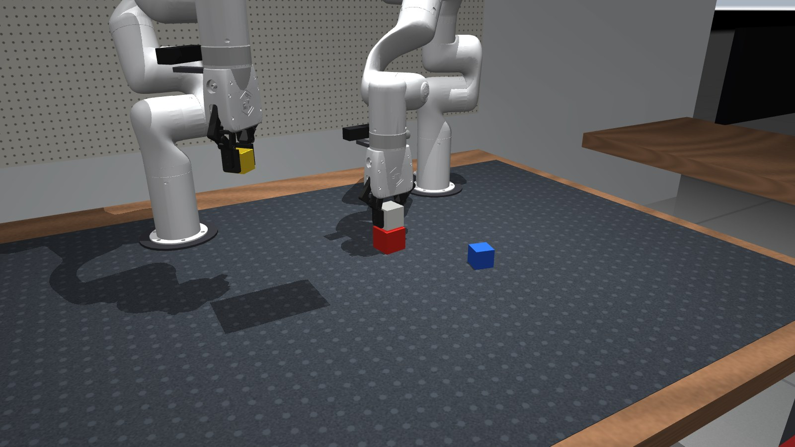
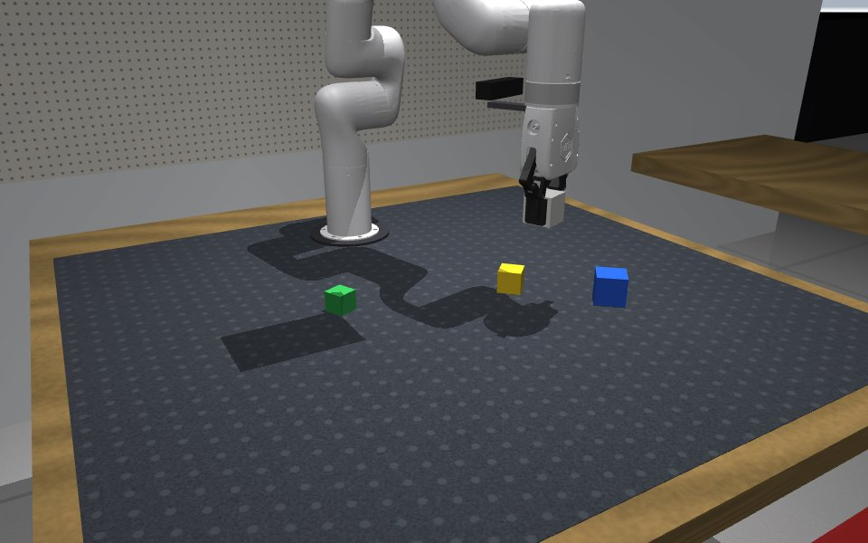
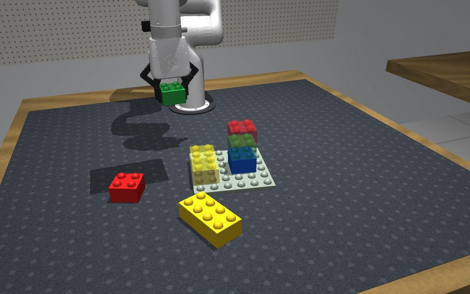
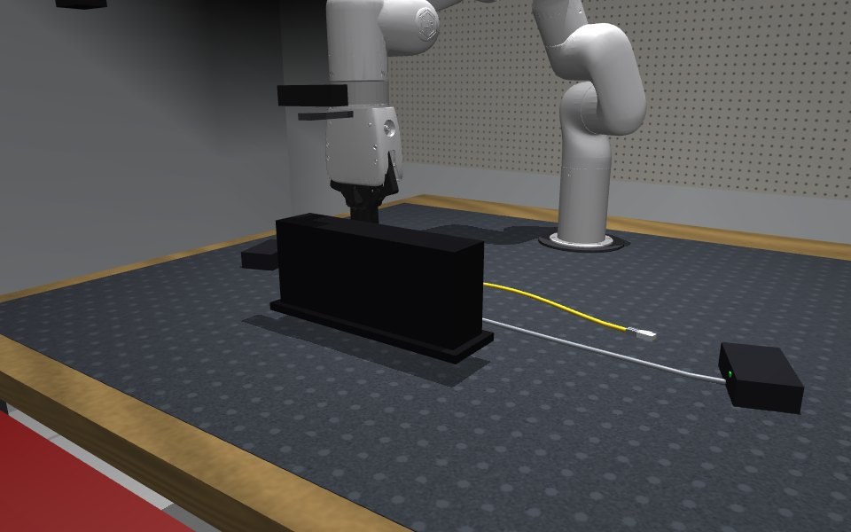
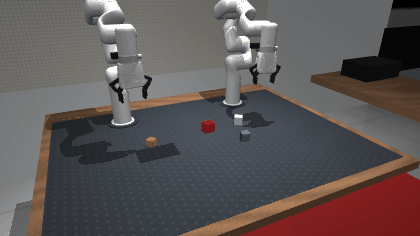
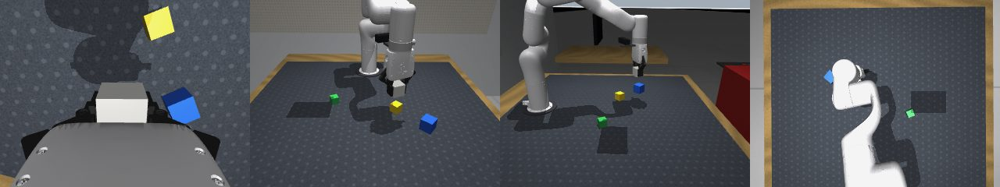
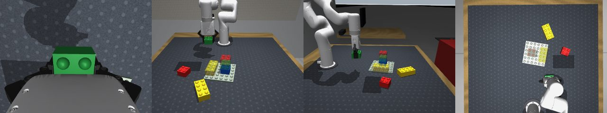
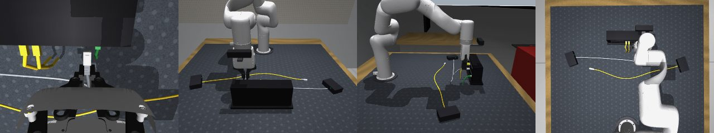

# RoboGym

MuJoCo manipulation tasks for the lab's two **UFACTORY xArm 7**, built for research on world-model
failure detection, latent steering, test-time adaptation and long-horizon manipulation: every episode
is reproducible, labelled, and can be rewound to any step and branched.



## Tasks

| Cube stacking | Oversized LEGO | Ethernet plugging |
|:---:|:---:|:---:|
|  |  |  |
| stack 2-4 cubes by size (or a shown pattern) | press 2-4 bricks onto a baseplate following a target model | plug 1-2 RJ45 cables into the lit ports of a patch panel |

Each task has a scripted, closed-loop expert that produces demonstrations, and the horizon (number of
cubes / bricks / cables) is a per-episode knob. With `bimanual=True` two arms work together: each takes
the objects on its side of the bench and they take turns at the shared stack, plate or panel.



## What you get

* **Robot**: the Menagerie xArm 7 with the xArm gripper (one or two arms), a wrist camera per arm and
  three fixed cameras; 20 Hz Cartesian control with a compliant insertion mode; a wrist force-torque
  wrench in the proprioceptive state (28-D per arm).
* **Failures**: 9 injected kinds (drop, weak grip, misgrasp, premature release, bump, stall, plus three
  per task), labelled separately from what physically happened, with onset times.
* **Out-of-distribution shifts**: lighting, appearance, sensor and physics families plus task-specific
  ones (cube size, tight fit, dense ports, LED distractors, ...), each with a severity.
* **Test-time regimes**: physics knobs (friction, mass, arm gains, gripper force, actuation delay,
  proprio noise, ...) that switch on mid-episode or on a schedule, and the usual continual-adaptation
  stream protocols (`sudden`, `gradual`, `recurring`, `mixed`, `in_episode`) with per-step labels.
* **Exact rewind**: `get_state` / `set_state` restore physics, controller and latch state bit for bit, so
  K candidate action chunks can be executed from the same moment.
* **Datasets** in the layout of the lab's real-robot recordings (`episode.parquet`, one mp4 per camera,
  `annotations.json`, `feature_report.json`) plus full simulator snapshots per step; a resumable
  multiprocess generator; a Gymnasium wrapper.

Robot cameras for each task (wrist, front, side, top):





## Install

```bash
git clone https://github.com/carlo-scr/RoboGym.git && cd RoboGym
uv venv --python 3.11 .venv && uv pip install --python .venv/bin/python -e ".[dev,notebooks]"
.venv/bin/pytest -q tests          # ~8 min on a laptop
```

## Use

```python
from robogym.env import RoboGymEnv

env = RoboGymEnv("lego", bimanual=True)         # "cube_stack" | "lego" | "cable_plug"
obs = env.reset(seed=0, shifts=["slippery"], severity=0.7)
ex = env.task.make_expert(env, seed=0)          # scripted expert (both arms here)
while not ex.done:
    obs = env.step(ex.act())                    # action: 8-D per arm, obs: 28-D per arm
    info = env.info()                           # stage, progress, success, regime
img = env.render("right_wrist")
snap = env.get_state(); env.set_state(snap)     # exact rewind
env.set_regime({"pad_friction": 0.3})           # online test-time shift
```

```bash
python scripts/generate_dataset.py --task cube_stack --out data/cubes --n 200 --workers 8
python scripts/generate_dataset.py --task lego --out data/lego_tta --stream mixed --n 40
python scripts/benchmark_experts.py --tasks cube_stack lego cable_plug --n 40
python scripts/render_gallery.py --out media --video
python notebooks/build.py --execute             # 00_tour, 01_failures_shifts_regimes, 02_data_and_research_hooks
ROBOGYM_PRESET=smoke python notebooks/src/04_benchmark.py   # or open notebooks/04_benchmark.ipynb on a Colab A100
# Colab: the repo is private, so add a Colab secret GITHUB_TOKEN (fine-grained token with read access) before running a notebook
pip install lerobot && python notebooks/src/05_offtheshelf.py   # LeRobot ACT / Diffusion / VQ-BeT (+ SmolVLA, pi0.5 on GPU), GIFs, figures
# notebooks/06_fast_a100.ipynb: the same pipeline with the `fast` preset, first results on one A100 in about an hour
```

Every modelling assumption that is not measured on the real cell (mounting, cameras, bench, object
sizes, tolerances) is a field in [robogym/config.py](robogym/config.py); `make_cfg(task, **dotted)`
or `RoboGymEnv(task, **dotted)` override it, e.g. `RoboGymEnv("lego", **{"task.scale": 2.0})`.

## Learners, benchmark protocol and recovery data

* **`robogym.learn`**: Diffusion Policy (state or image observations, chunked relative targets), frame
  autoencoder, probabilistic latent world model with aleatoric / epistemic / NLL scores, a conformal
  failure monitor, inference-time steering (best-of-K, tilted selection, abstention) and the RQ1 oracle
  ranking that executes every candidate chunk from the same simulator state. `scripts/train_policy.py`
  trains and evaluates on the test split; `scripts/rq1_oracle.py` runs the ranking;
  `notebooks/03_learn_and_steer` chains everything (laptop smoke preset or Colab A100).
* **`robogym.bench`**: versioned seed splits (train / cal / test / shift / stream), paired shift suites
  (visual, physics, task-specific) at three severities, named regime conditions, Wilson intervals, paired
  deltas with harm rates, detection metrics and a results JSON, so methods are compared the same way.
* **Recovery demonstrations**: `EpisodeSpec(recover=True)` lets the expert notice a failed subgoal
  (privileged) and redo it from the objects' current poses, with `recover_start` / `recover_end` labels.
  Injected LEGO partial presses go from 1/4 to 4/4 recovered, cube drops from 2/4 to 3/4; cable
  recoveries mostly fail (the plug is left in the jack, which the re-grasp does not handle yet).
* **Sensing**: `render(cam, mode="depth" | "seg")`, wrist force-torque noise and bias, sensing latency
  (regimes `ft_noise`, `ft_bias`, `obs_delay`), and wider nominal visual randomisation (bench and mat
  textures, light poses, camera intrinsics).
* **Real cell**: `robogym.real.RealXArmEnv` implements the same contract over the xArm SDK and
  RealSense (a dry backend runs without hardware), records episodes in the same layout, and
  `robogym.real.twin` measures sim-to-real divergence by replaying a recording. Untested on hardware.

## Policies and the planning / execution split

`robogym.policies` puts every controller behind one interface so the benchmark compares them the same
way: the scripted expert (with actuation-noise and injected-failure knobs), learned chunk policies
(Diffusion Policy, ACT, MLP; `scripts/train_policy.py --arch`), an adapter for LeRobot checkpoints, and
`HierarchicalPolicy(planner, executor)`, where the *planner* (oracle, rule-based, deliberately corrupted,
or an LLM reading a text scene description) and the *executor* (the expert's subgoal routines, with
noise or injected failures, or a goal-conditioned learned skill) are swapped independently.
`robogym.lh` evaluates any policy over horizons on paired seeds and attributes the first failure of an
episode to planning (`plan`, `plan_goal`) or execution (`exec_grasp`, `exec_place`) from the simulator's
labels alone, with horizon curves against the independent-subgoal prediction. `notebooks/04_benchmark`
runs the whole pipeline per task (datasets, the three architectures, world model and monitor, the
benchmark) and is safe to interrupt: every stage resumes from what is on disk. `notebooks/05_offtheshelf`
exports the demonstrations to the LeRobot format, trains LeRobot's ACT, Diffusion Policy and VQ-BeT (and
fine-tunes SmolVLA / pi0.5 on a GPU), benchmarks them next to the expert and the hierarchical policies, and
renders captioned rollout GIFs and the summary figures; `notebooks/06_fast_a100` is the same notebook with a
one-hour A100 preset (fewer demonstrations and steps, trainings sharing the GPU, GPU-side evaluation).

```bash
python scripts/eval_policies.py --task cube_stack --horizons 2 3 4 --n 20 --workers 8 --out runs/lh_cubes \
  --policies expert "expert:exec_noise=0.004" "hier:oracle+scripted" "hier:corrupt(p_swap=0.5)+scripted" \
  chunk:runs/dp_cubes/policy.pt "hier:oracle+chunk(runs/dp_cubes/policy.pt)" "hier:llm+scripted"
```

## Expert success

`scripts/benchmark_experts.py --n 40` (physics only; shifts at severity 0.7):

| task | horizon | nominal | slippery | heavy object | weak gripper | actuation delay | arm gain drift |
|---|---|---|---|---|---|---|---|
| cube_stack | 1 / 2 / 3 placements | 1.00 / 1.00 / 1.00 | 1.00 / 1.00 / 1.00 | 1.00 / 1.00 / 1.00 | 1.00 / 1.00 / 1.00 | 1.00 / 1.00 / 1.00 | 1.00 / 1.00 / 0.91 |
| lego | 2 / 3 / 4 bricks | 1.00 / 1.00 / 0.56 | 1.00 / 0.86 / 0.36 | 1.00 / 0.95 / 0.55 | 1.00 / 0.91 / 0.55 | 1.00 / 0.91 / 0.55 | 0.71 / 0.45 / 0.09 |
| cable_plug | 1 / 2 cables | 0.82 / 0.61 | 0.87 / 0.52 | 0.93 / 0.52 | 0.87 / 0.52 | 0.73 / 0.32 | 0.67 / 0.44 |

Bimanual (8 seeds): cube stacking 8/8, LEGO 8/8, cable plugging 4/8 (each arm latches its cable about
70 % of the time; the side-mounted arms insert at an angle). Failed episodes are labelled
(`jammed`, `not_seated`, `dropped`, `misaligned`, ...), so they are data, not waste. Arm-gain drift and
actuation delay are the most hurtful regimes by design.

## Layout

| | |
|---|---|
| [robogym/env.py](robogym/env.py) | `RoboGymEnv`: controller, observations, labels, rendering, snapshots, regimes |
| [robogym/tasks/](robogym/tasks/) | task interface and the three tasks |
| [robogym/experts/](robogym/experts/) | single-arm experts, the bimanual coordinator, failure hooks |
| [robogym/shifts.py](robogym/shifts.py), [failures.py](robogym/failures.py), [streams.py](robogym/streams.py) | OOD shifts, injected failures, test-time protocols |
| [robogym/datagen.py](robogym/datagen.py), [parallel.py](robogym/parallel.py), [research.py](robogym/research.py) | episodes and export, parallel generation, branching and monitor labels |
| [scripts/](scripts/), [notebooks/](notebooks/), [tests/](tests/) | CLI tools, Colab-ready notebooks, test suite |

## Roadmap

1. Real cell numbers: mounting, gripper force setting, camera poses and intrinsics, bench, object sizes.
2. Hand-over and hold-and-place bimanual behaviours (the current coordination is turn-taking).
3. Disassembly: unplug, pull bricks apart.
4. Image-based policies and the lab's latent world-model monitors on these datasets; LeRobot export.
5. MJX / MuJoCo Warp batch stepping for GPU counterfactual scoring.

## License

MIT. The xArm 7 meshes are BSD-3-Clause (UFACTORY Inc., via MuJoCo Menagerie), see
[robogym/assets/xarm7/LICENSE](robogym/assets/xarm7/LICENSE).
